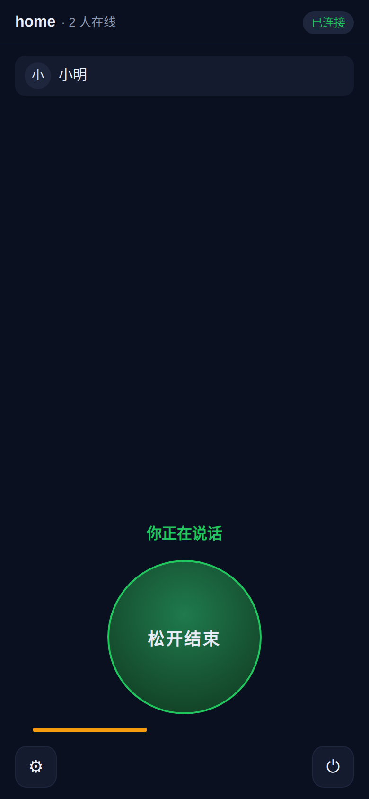
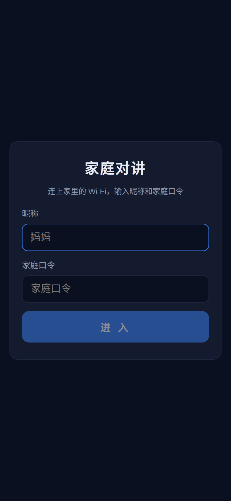

<div align="center">

# HomeTalker · 家庭内网对讲

**把手机变成对讲机，只在家里 Wi-Fi 里说话。**

[快速开始](#快速开始) · [部署文档](DEPLOY.md) · [使用说明](#使用说明) · [工作原理](#工作原理)

</div>

---

## 这是什么

部署在你自己家里的服务器上的网页对讲应用。手机浏览器打开就能用，**不需要账号、不需要数据库、不出内网**。

<div align="center">


</div>

- 📱 **手机浏览器直接用**，加到桌面后全屏运行，像原生 App
- 🎙️ **按住说话**，同一时刻只有一个人能说，跟真对讲机一个逻辑
- 🏠 **纯内网**，语音不经过任何第三方，也不落盘、不录音
- 🔒 **一个家庭口令**就能挡住外人，不用注册登录
- 🪶 **服务端零状态**，只有 1 个运行时依赖（`ws`），镜像小、吃资源少

---

## 快速开始

在有 Docker 的内网服务器上：

```bash
git clone https://github.com/wangqiang1988/hometalker.git
cd hometalker
cp .env.example .env
vi .env                       # 改 SITE_ADDR（服务器 IP）和 FAMILY_CODE（家庭口令）
docker compose up -d --build
```

导出证书并发给家人：

```bash
docker compose cp caddy:/data/caddy/pki/authorities/local/root.crt ./rootCA.crt
```

然后在手机上装好这个根证书（**iOS 要两步，Android 一步**，详见 [DEPLOY.md](DEPLOY.md)），浏览器打开 `https://<你的IP>` 就能说话了。

> ⚠️ **必须用 HTTPS**。浏览器的麦克风接口只在安全上下文可用，`http://192.168.x.x` 会被直接禁用 —— 表现是「能听不能说」，而且没有绕过办法。

完整步骤、证书安装、局域网设置和排障都在 **[DEPLOY.md](DEPLOY.md)**。

---

## 使用说明

### 进房间

1. 浏览器打开 `https://<你的IP>`
2. 填**昵称**（如"妈妈"）和**家庭口令** → 点「进入」
3. 首次会请求麦克风权限，允许即可。之后昵称和口令记在本机，下次直接进。

### 说话

按住底部大圆按钮开始说话，松开结束。界面元素：

| 元素 | 含义 |
|---|---|
| 顶部 `home · N 人在线` | 房间名和在线人数，右侧是连接状态 |
| 成员列表 | 在线的人；正在说话的人会高亮并标注「说话中」 |
| 「你正在说话…」 | 状态条，告诉你麦现在归谁 |
| 底部大圆按钮 | **按住说话**（松手即结束，绿色表示正在发言） |
| 黄色条 | 本地麦克风电平 |
| 蓝色条 | 远端收到的声音电平 |
| ⚙ | 设置：收听音量、麦克风增益、清除本机信息 |

### 抢麦

默认**抢占**模式：你按住说话就直接接管麦，正在说话的人会被自动打断。觉得太容易打断，`.env` 里改：

```ini
SPEAK_MODE=exclusive
```

这样别人在说话时你会收到「XXX 正在说话」，必须等他松手。

### 几点建议

- **说话人尽量戴耳机**。网页没法把 iPhone 的输出切到「听筒」，外放时自己会听到回声（浏览器 AEC 能压掉大部分，戴耳机最干净）
- **按住说话时屏幕不会熄灭**（应用会自动申请屏幕常亮），别手动锁屏
- 锁屏后网页会被浏览器冻结导致断线，**回到前台会自动重连**，不用管

---

## 工作原理

```
   手机浏览器                     你的内网服务器
 ┌──────────────┐            ┌───────────────────────────┐
 │  Web App     │  WSS       │  Caddy :443                │
 │  PWA         │◄──────────►│   TLS 终止（本地 CA 签发）   │
 │              │            │            │               │
 │  AudioWorklet│            │            ▼               │
 │  采集 / 播放  │            │  server :8443 (Node)       │
 └──────────────┘            │   · 家庭口令校验             │
                             │   · 麦权状态机              │
                             │   · 音频字节转发（不编解码）  │
                             └───────────────────────────┘
```

**为什么这么简单？** 因为家庭对讲天然是「1 个人说 → N 个人听」，服务端只要**把字节从一个人搬到其他人**就行：

- **控制消息**走 WebSocket 的 JSON 文本帧，**音频**走二进制帧 —— 浏览器原生区分这两种帧类型，不用自己设计协议
- 音频格式：**16 kHz / 单声道 / Int16LE / 20 ms 一帧**，服务端**只搬字节不编解码**，CPU 占用接近 0
- 浏览器侧用 `AudioWorklet` + `AudioContext({sampleRate:16000})`，整个音频图原生跑 16 kHz，连重采样都不用写
- 麦克风自带浏览器的回声消除（AEC）、降噪（NS）、自动增益（AGC）
- **服务端只转发当前说话人的帧** —— 抢麦切换时天然无残留音频，半双工也是免费的

### 麦权状态机

服务端只有两个状态：`谁在线`、`麦在谁手上`。麦权的**唯一入口**是 `setSpeaker()`：

```
        acquire                    release / 超时 / 断线
  idle ──────────► speaking ─────────────────────────► idle
                    │  ▲                              ▲
                    │  └── heartbeat（续租）───────────┘
                    └── 发射保护窗口内不可再 acquire
```

- 抢占时旧说话人会收到 `speaker` 事件自动停发，服务端也立刻丢弃他的帧
- 发言超时（默认 60 秒）自动放麦，防止有人霸占
- 连接断开自动放麦，**绝不留下"僵尸麦"**

### 协议

单条 WebSocket 承载控制与音频：

| 方向 | 消息 |
|---|---|
| C→S | `{t:"join", name, code}`（首条必须是）、`{t:"speak", on}`、`{t:"mute", on}` |
| C→S | **二进制帧** = 20 ms 音频 |
| S→C | `{t:"welcome", you, room, members, speaker, cfg}`、`{t:"members", members}`、`{t:"speaker", id}`、`{t:"error", code, message}` |
| S→C | **二进制帧** = 转发的音频 |

---

## 项目结构

```
hometalker/
├── docker-compose.yml      # caddy + server 两个服务
├── Caddyfile               # tls internal + reverse_proxy
├── .env.example            # 配置模板
├── DEPLOY.md               # Docker 部署文档
├── server/                 # Node 20 + TypeScript（运行时仅依赖 ws）
│   └── src/
│       ├── index.ts        # HTTP + WebSocket upgrade + 心跳
│       ├── room.ts         # 麦权状态机（核心）
│       ├── static.ts       # 静态文件 + gzip + 缓存失效校验
│       ├── config.ts       # env 解析与校验
│       └── log.ts
├── web/                    # React 19 + Vite（PWA）
│   ├── public/worklets/    # 采集/播放 AudioWorklet（纯 JS，不走打包链）
│   └── src/
│       ├── App.tsx         # 状态机：门禁 → 连接 → 房间
│       ├── net/ws.ts       # 连接 + 指数退避重连
│       ├── audio/audio.ts  # 音频管线
│       └── pages/          # Gate（门禁）/ RoomPage（房间）
└── scripts/
    ├── smoke.mjs           # 协议层自测（19 项）
    ├── behavior.mjs        # 服务端行为自测（9 项）
    ├── browser-e2e.mjs     # 真实浏览器端到端自测（19 项）
    ├── screenshots.mjs     # 生成 README 截图
    └── gen-icons.mjs       # 纯 Node 生成 PWA 图标
```

**3217 行代码**，服务端运行时依赖只有 `ws`，前端只有 `react` + `react-dom`。

---

## 开发

```bash
npm --prefix server install
npm --prefix web install

npm run build        # 前端 + 后端
npm run icons        # 重新生成 PWA 图标

# 本地起服务（不用 Docker）
cd server && FAMILY_CODE=dev1234 PUBLIC_DIR=../web/dist node dist/index.js

# 前端开发服务器（自动代理 /api 和 /ws 到 8443）
cd web && npm run dev
```

### 自测

三个脚本，都输出 `✓ / ✗` 和汇总：

```bash
# 1) 协议层：鉴权、在线状态、麦权、音频转发（19 项）
node scripts/smoke.mjs

# 2) 服务端行为：抢麦模式、发言超时、断线放麦（9 项）
#    先用 SPEAK_MODE=exclusive MAX_SPEAK_MS=1500 起服务再跑
node scripts/behavior.mjs

# 3) 真实浏览器端到端：麦克风 → worklet → WebSocket → 服务端 → 另一端播放（19 项）
node scripts/browser-e2e.mjs
```

第 3 个需要 Chrome 和 `puppeteer-core`（已列在 devDependencies），用 Chrome 的 fake audio device 跑真实的音频链路。

---

## 已知限制

1. **iOS 无法强制切到"听筒"输出**（网页没有 `setSinkId` API）。外放说话时自己会听到回声，靠浏览器 AEC 缓解，**戴耳机最干净**
2. **手机锁屏 / 切后台 → 网页被浏览器冻结 → 断线**。这是浏览器的限制，网页方案无解。回前台会自动重连
3. **音频延迟比原生 App 大 100~200 ms**（20 ms 帧 + 抖动缓冲）。对讲场景可接受
4. **不能同时多人说话**（半双工）。这是对讲机语义
5. **只在家里 Wi-Fi 下用**。出门后连不上（除非自己加 VPN / 内网穿透）
6. **服务端能看到明文 PCM**（它只在内存里转发，不落盘、不录音）

---

## 安全

- 语音**不经过任何第三方**，全部在你家局域网内点对点传输
- 语音**不落盘、不录音**，服务端不保留任何历史数据
- 口令用**恒定时间比较**（`timingSafeEqual`），防时序侧信道
- 口令错误 10 次锁 60 秒，防暴力猜解
- 口令**不放进 URL**，不会进日志和浏览器书签
- 口令错误时**不会**被存到手机本机
- Caddy 关闭了管理端点、移除了 `Server` 响应头、加了 `X-Content-Type-Options: nosniff`
- 服务端无状态，重启不丢数据；唯一的持久化是 Caddy 里的证书

> 本项目**没有**为公网部署做加固（无限速、无 IP 白名单、无审计）。真要开放到公网，请自行加一层反向代理做限流，或者用 Tailscale 组网只让家人访问。
